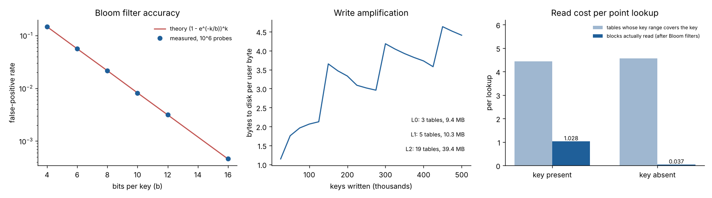
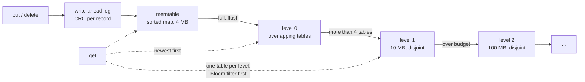

# lsm-kv

A log-structured merge-tree storage engine in Rust, the design behind LevelDB, RocksDB and
Cassandra. It has no dependencies. Every on-disk format is written out here: the write-ahead log,
the sorted tables, the Bloom filters and the manifest. It is tested against a `BTreeMap` model, and
against crashes at every possible byte of a torn write.



## How it works



- **Writes** are appended to the log and inserted into the memtable. Nothing is updated in place.
- **Flush.** A full memtable becomes an immutable sorted table in level 0. The manifest is updated,
  and only then is the log emptied.
- **Leveled compaction.** Too many level-0 tables are merged with the overlapping part of level 1. A
  level that outgrows its budget (10 MB, then ×10 per level) pushes one table's key range down into
  the next level, round-robin. The merge keeps the newest version of each key and drops a deletion
  marker only once nothing older can exist below it.
- **Reads** check the memtable, then level-0 tables newest first, then at most one table per deeper
  level. A table is skipped if the key is outside its range or its Bloom filter says no.
- **The manifest** lists the live tables. It is rewritten to a temporary file, synced, and renamed
  over the old one, an atomic switch-over. On open, tables it doesn't name (left by an interrupted
  flush or compaction) are deleted.

```text
table: [data block]...[bloom block][index block][footer]
  data block   [key len][value len | tombstone][key][value]... + crc32
  bloom block  [k][bits] + crc32                (10 bits/key, k = 7)
  index block  [last key][offset][length] per data block + crc32
  footer       offsets, lengths, entry count, magic number
```

## Correctness

| test | what it does |
|---|---|
| model, two seeds | 30,000 random puts, deletes, gets and range scans against a `BTreeMap`, with the database closed and reopened at random. Tiny size limits force hundreds of flushes and compactions, through up to three levels |
| every torn WAL prefix | writes 40 records, then for **every byte position** cuts the log there and reopens. Exactly the complete records must be present, in order; the torn tail must be truncated so later writes survive |
| corrupt WAL record | flips a bit in record 5 of 10: records 0–4 survive, the rest are dropped |
| interrupted flush | an orphan half-written table plus a stray `MANIFEST.tmp`: the orphan is deleted, and the log replays everything |
| corrupt table block | flips a byte inside a data block: lookups there return an `InvalidData` error, never a wrong value |
| tombstones | deletes half the keys and pushes the markers to the bottom level; the keys stay deleted after reopening |
| Bloom filters | at 10 bits per key, over 97 % of lookups for absent keys are answered without reading a block |
| CRC-32 | the standard check value `crc32("123456789") = 0xCBF43926` |

## Performance

500,000 random-order inserts with 100-byte values (58 MB of user data), then 200,000 random lookups
of present and of absent keys. Default options, release build, one thread, on a 2-vCPU cloud VM
(`cargo run --release --example bench`):

| | |
|---|---|
| inserts | **176,000 per second** |
| write amplification | **4.45**: 66.5 MB of log plus 191 MB of tables written for 58 MB of data |
| shape after loading | L0: 3 tables (9.4 MB) · L1: 5 tables (10.3 MB) · L2: 19 tables (39.4 MB) |
| lookups of present keys | 58,000 per second; 4.4 tables cover the key, **1.03 blocks read** |
| lookups of absent keys | 898,000 per second; 4.6 tables cover the key, **0.037 blocks read** |

The absent-key number is the Bloom filters at work. Each probe consults 4.6 tables, and each filter
wrongly says "maybe" 0.8 % of the time, so 4.6 × 0.008 = 0.037 block reads per lookup, exactly as
measured. The left panel of the figure checks the filter against its theoretical false-positive rate
(1 − e^(−k/b))^k: measured 0.80 % against a predicted 0.82 % at 10 bits per key, and the match holds
from 4 to 16 bits per key. Write amplification steps up each time a compaction rewrites a level,
which is the sawtooth in the middle panel.

## Run it

```bash
cargo test --release        # about 3 s
cargo run --release --example bench > docs/bench.json && python3 scripts/plot_bench.py
```

## Limits

- Single-threaded. Flushes and compactions run inline in the write that triggers them, so one write
  occasionally takes much longer than the rest. Real engines compact in the background.
- `sync` is off by default: the log is handed to the operating system on every write but fsynced only
  when `Options::sync` is set. Flushes, compactions and manifest updates always fsync.
- No block cache, no compression, and no prefix compression of keys inside blocks.
- Scans materialise their results in memory.

## References

- P. O'Neil, E. Cheng, D. Gawlick, E. O'Neil, *The Log-Structured Merge-Tree (LSM-Tree)*, Acta Informatica 33 (1996).
- B. H. Bloom, *Space/Time Trade-offs in Hash Coding with Allowable Errors*, CACM 13 (1970).
- A. Kirsch, M. Mitzenmacher, *Less Hashing, Same Performance: Building a Better Bloom Filter*, ESA (2006).
- The LevelDB implementation notes (`doc/impl.md`), for leveled compaction and the manifest.

## License

MIT
